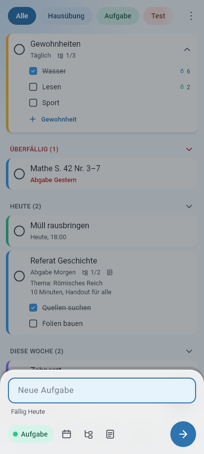
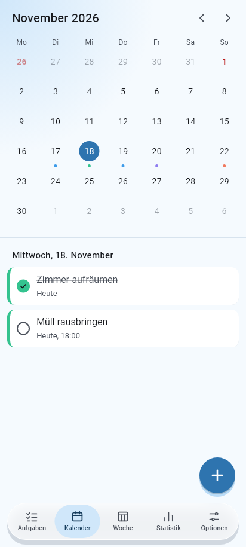
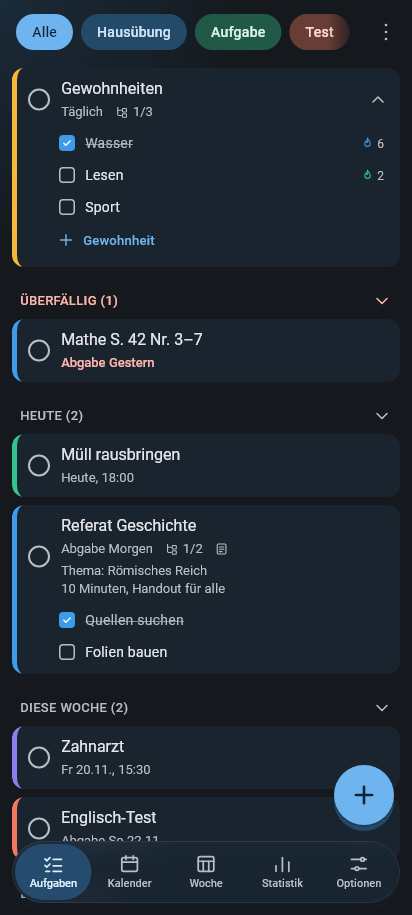

# Todo-Planer

Aufgaben, Gewohnheiten, Kalender und Wochenplan in einer App – für Android, Windows und Linux, gebaut mit Flutter. Funktioniert ohne Konto und ohne Internet; wer will, gleicht Handy und PC über eine eigene Datenbank ab.

## Installieren

**Android:** Unter [Releases](https://github.com/crunkyii/todo-planer/releases/latest) die Datei `todo-planer-<Version>.apk` herunterladen und öffnen. Beim ersten Mal fragt Android, ob Apps aus dieser Quelle installiert werden dürfen.

**Windows:** Unter [Releases](https://github.com/crunkyii/todo-planer/releases/latest) die Datei `todo-planer-<Version>-windows.zip` herunterladen, entpacken und `todo_liste.exe` starten.

**Selbst bauen** (auch für Linux): siehe [docs/bauen.md](docs/bauen.md).

Beim ersten Start fragt die App, wo die Aufgaben gespeichert werden sollen: **nur auf diesem Gerät** (kein Konto, keine Einrichtung) oder **auf allen Geräten** (eigene kostenlose Supabase-Datenbank).

## Was es kann

- **Aufgaben** mit Kategorien, Uhrzeit, Unteraufgaben, Notizen, Suche und Erinnerungen
- **Vorlauf** je Kategorie – eine Hausübung steht schon am Vortag in der Liste
- **Weniger voll**: je Kategorie einstellbar, ab wann ihre Aufgaben in der Liste stehen (z. B. Geburtstage erst in ihrer Woche)
- **Gewohnheiten** mit Serien-Flamme
- **Kalender** mit österreichischen Feiertagen, **Wochenplan** mit Zeitblöcken, **Statistik** mit Heatmap
- **Startbildschirm-Widgets** für Android
- **Export** als PDF, Text oder CSV
- **10 Themes**, hell/dunkel, Deutsch/Englisch
- **Offline zuerst**: Alles wird sofort am Gerät gespeichert und später abgeglichen

| Aufgaben | Neue Aufgabe | Kalender |
|---|---|---|
|  |  |  |

| Wochenplan | Statistik | Dunkel |
|---|---|---|
|  |  |  |

## Datenschutz

Deine Aufgaben bleiben am Gerät – oder in **deiner eigenen** Datenbank, wenn du den Abgleich einschaltest. Keine Werbung, kein Tracking, kein Konto beim Entwickler. Details: [docs/datenschutz.md](docs/datenschutz.md).

## Mehr erfahren

| Seite | Inhalt |
|---|---|
| [Was die App kann](docs/funktionen.md) | Alle Funktionen im Detail |
| [Auf allen Geräten](docs/sync.md) | Eigene Supabase-Datenbank einrichten, so funktioniert der Abgleich |
| [Datenschutz](docs/datenschutz.md) | Was gespeichert und übertragen wird |
| [Selbst bauen](docs/bauen.md) | Voraussetzungen, Starten, Windows- und Android-Build |
| [Tests](docs/tests.md) | Was getestet wird und wie man die Tests startet |
| [Aufbau](docs/aufbau.md) | Architektur, Ordner und Regeln für Änderungen am Code |

## Lizenz

[MIT](LICENSE)
